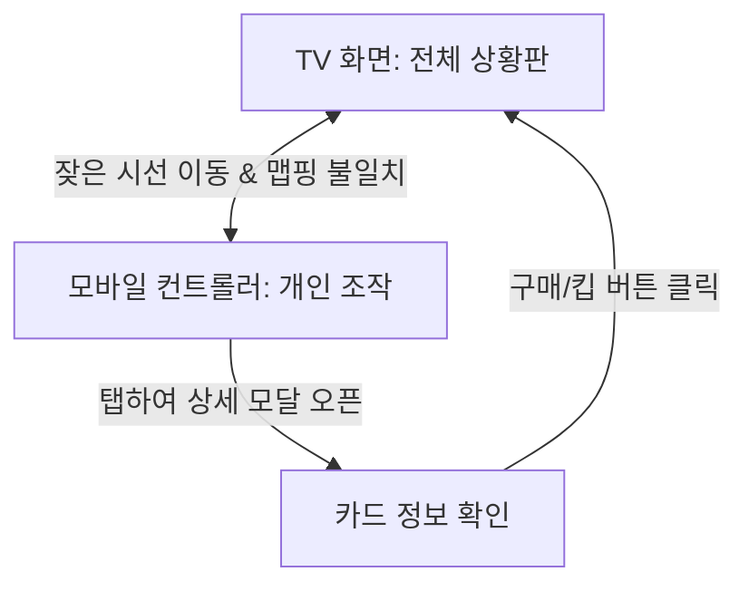
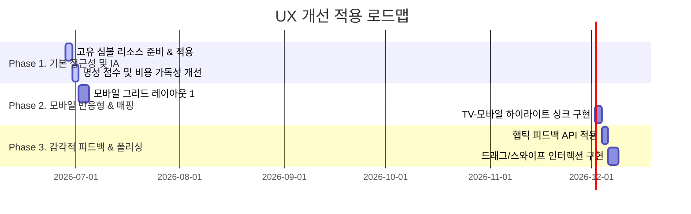

# Splendor Local Multiplayer: UX Design Improvement Plan
(스플렌더 로컬 멀티플레이어 게임을 위한 UX 디자인 개선안)

본 개선안은 스마트폰을 컨트롤러로 사용하고 TV/공유 모니터를 메인 보드로 사용하는 **이종 디스플레이(Dual-Screen) 환경**의 로컬 멀티플레이어 환경에서 사용자가 느낄 수 있는 인지적 피로를 줄이고, 접근성(색약/색맹 지원)을 개선하며, 보드게임 특유의 손맛(Tactile Feel)을 극대화하기 위해 작성된 UX 개선 계획서입니다.

---

## 1. 인지 부하 감소 (Cognitive Load Reduction)
### TV 화면(공유 상태)과 모바일 컨트롤러(개인 상태) 간의 시선 분산 최소화

**현황 및 문제점:**
* 플레이어는 자신의 스마트폰 화면(보석 가져오기, 카드 상세 구매 등)과 TV 화면(공유 보석 은행, 다른 플레이어의 자원 상황, 귀족 타일 등)을 끊임없이 번갈아 보아야 합니다.
* 모바일 컨트롤러의 카드 배치 방식과 TV 화면의 3단계 배치 방식이 시각적으로 완벽하게 맵핑되지 않아, 모바일에서 카드를 탐색할 때 TV 화면의 위치와 대조하는 과정에서 불필요한 인지 피로가 발생합니다.



**개선 방안:**

1. **공간적 레이아웃 동기화 (Spatial Mapping Alignment)**
   * 모바일 화면의 **개발 카드 구매** 탭 레이아웃을 TV 화면의 개발 카드 배치 형태(3단계 가로 정렬 그리드)와 완벽히 일치하도록 설계합니다.
   * 모바일 그리드에서 TV의 빈 카드 슬롯도 동일하게 비워두거나 회색조로 처리하여, 플레이어가 TV에서 본 카드를 모바일에서 찾을 때 별도의 위치 해석 과정 없이 직관적으로 같은 좌표의 요소를 탭할 수 있게 합니다.

2. **상호작용 하이라이트 (Focus Highlighting & TV HUD Sync)**
   * 플레이어가 모바일 화면에서 특정 카드를 탭하여 상세 보기 모달을 열거나 카드를 길게 누르고 있을 때, TV 화면의 해당 카드 테두리에 **해당 플레이어 고유 색상의 하이라이트 효과**를 표시합니다.
   * 예: "1P(Red)가 3단계 3번째 카드를 확인 중"임을 TV 화면에 은은한 펄스(Pulse) 애니메이션으로 보여줌으로써, 눈을 어디로 두어야 할지 방향성을 잡을 수 있도록 보조합니다.

3. **이벤트 히스토리 로그 가독성 강화**
   * 현재 로그는 TV의 우측 하단에 작은 텍스트로 누적되어 가독성이 낮습니다.
   * 주요 액션(예: "루키님이 3단계 카드를 구매했습니다", "황금 보석 1개를 가져갔습니다") 발생 시, TV 화면 중앙 상단에 **자막 형태의 팝업 알림(Toast)**을 1.5초간 노출하여 굳이 텍스트 로그를 훑어보지 않아도 상대방의 차례가 어떻게 끝났는지 직관적으로 인지하게 돕습니다.

---

## 2. 접근성 개선 (Accessibility)
### 색맹·색약 플레이어를 위한 보석 및 카드 식별용 심볼 도입

**현황 및 문제점:**
* 현재 구현체([App.jsx](file:///workspace/splender/src/App.jsx#L160-L171))의 보석 렌더링 방식(`renderGemIcon`)은 색상에만 크게 의존하고 있으며, 텍스트 레이블은 영문 이니셜의 첫 글자(`color[0].toUpperCase()`)를 사용하고 있습니다.
* 이는 치명적인 버그 및 접근성 한계를 유발합니다:
  * **Blue**(사파이어)와 **Black**(오닉스)이 둘 다 **"B"**로 표시됩니다.
  * **Green**(에메랄드)과 **Gold**(황금)가 둘 다 **"G"**로 표시됩니다.
  * 적록색약 및 완전색맹 사용자의 경우, 색상 구분이 불가능할 뿐만 아니라 이니셜마저 중복되어 게임 플레이가 불가능해집니다.

```diff
- {color === 'gold' ? 'G' : color[0].toUpperCase()}
+ // 색상별 고유 기하학적 형태 및 유니코드 심볼 매핑 필요
```

**개선 방안:**

1. **보석별 고유 기하학적 기호 및 그래픽 심볼 도입**
   보석마다 확실히 구별되는 유니코드 특수 기호 또는 전용 SVG 아이콘을 삽입하여 색상 없이 형태만으로도 즉시 구별할 수 있도록 합니다.

   | 보석 종류 | 기조 색상 | 고유 특수문자 기호 | 시각적 형태 모티브 |
   | :--- | :--- | :---: | :--- |
   | **다이아몬드 (White)** | 화이트/실버 | `✧` 또는 `♢` | 4각 다이아몬드 별 모양 |
   | **사파이어 (Blue)** | 블루 | `▲` 또는 `⬦` | 역삼각형 또는 물방울 형태 |
   | **에메랄드 (Green)** | 그린 | `⬡` 또는 `☘` | 육각형 또는 클로버 형태 |
   | **루비 (Red)** | 레드 | `◆` 또는 `🛑` | 마름모 또는 방패 모양 |
   | **오닉스 (Black)** | 다크 그레이/블랙 | `●` 또는 `♣` | 정원(Circle) 또는 클로버 모양 |
   | **황금 (Gold)** | 골드/옐로우 | `★` 또는 `🪙` | 5각 별 모양 또는 코인 형태 |

2. **UI 컴포넌트 통합 적용**
   * **보석 토큰**: 모바일과 TV의 보석 토큰 배경에 색상 그라데이션을 적용하는 동시에, 중앙에 흰색/검은색 고대비로 위의 고유 심볼을 노출합니다.
   * **카드 비용 아이콘**: 개발 카드 하단에 표시되는 비용 아이콘 내에도 해당 보석 심볼을 함께 축소해서 보여줍니다. (예: `[◆ 3]` 빨간 배경에 흰색 다이아몬드 심볼과 숫자 3)
   * **텍스트 레이블 병행 표기**: 모바일 조작부에는 '루비', '오닉스' 등 한글 텍스트 레이블을 보석 아이콘 밑에 직관적으로 배치합니다.

---

## 3. 손맛과 피드백 (Tactile Feel & Feedback)
### 물리적인 칩과 카드를 만지는 듯한 감각적 피드백 제공

**현황 및 문제점:**
* 모바일 웹 환경에서 버튼을 누르고 화면을 탭하는 단순 정적 입력 방식은 보드게임 특유의 '보석 칩을 짤랑이며 가져오는 느낌'이나 '개발 카드를 내 앞에 가져다 놓는 손맛'을 전혀 재현하지 못하고 있습니다.

**개선 방안:**

1. **햅틱 피드백 (Web Vibration API) 도입**
   스마트폰의 진동 모터를 정밀 제어하여 터치 시 실제 보드게임 구성품을 다루는 듯한 질감을 흉내 냅니다.
   * **보석 선택 시 (Clink Effect)**: 보석 토큰을 탭할 때마다 `navigator.vibrate(8)` 또는 `navigator.vibrate([10])`과 같은 아주 미세하고 날카로운 단독 진동을 주어, 플라스틱/세라믹 칩이 서로 부딪히는 짤랑이는 피드백을 구현합니다.
   * **카드 구매/킵 성공 시**: `navigator.vibrate([30, 40, 30])` 등 부드럽게 이어지는 진동 패턴을 통해 '결정적 행동 성공'의 손맛을 전달합니다.
   * **턴 전환/내 차례 시작**: `navigator.vibrate(100)`을 호출하여 상대방 플레이 도중 딴짓을 하던 플레이어가 즉시 자신의 턴임을 인지하도록 환기합니다.

2. **드래그 앤 드롭 (Drag & Drop) 및 스와이프 제스처**
   * **보석 가져오기**: 보석을 탭해서 올리는 대신, 화면 중앙의 은행 보석 칩을 손가락으로 쓸어내려(Swipe Down) 하단의 내 보석 가방(Wallet) 영역으로 끌어오는 인터랙션을 도입합니다.
   * **개발 카드 구매/킵**: 카드를 더블 탭하는 대신, 카드를 위로 쓸어올리면(Swipe Up - TV 화면 방향으로 던지는 제스처) **구매**, 내 쪽으로 쓸어내리면(Swipe Down - 내 핸드로 가져오는 제스처) **킵**이 되도록 슬라이드 제스처를 설계합니다.

3. **마이크로 애니메이션 효과**
   * 모바일에서 보석을 가져가면, 해당 보석 컴포넌트가 순간적으로 1.1배 커졌다가 수축하며, 파티클(사방으로 튀는 미세한 빛 알갱이 효과) 애니메이션이 일어나도록 CSS Transition과 Keyframe 애니메이션을 추가합니다.

---

## 4. 정보 아키텍처 (Information Architecture)
### 가독성 개선 및 빠른 탐색을 위한 화면 레이아웃 최적화

**현황 및 문제점:**
* 개발 카드에서 명성 점수(PV)와 구매 비용(Cost)의 크기 및 대조가 약해 한눈에 훑어보기(Scanning) 어렵습니다.
* 플레이어가 구매 가능한 카드인지 아닌지 직접 계산해야 하는 번거로움이 있습니다. (현재도 `canAffordCard` 연산은 있으나 보더 라인 정도만 얇게 표현되어 가시성이 떨어집니다.)

```
[ 기존 카드 정보 구조 ]
┌─────────────────────────┐
│ [PV]             [BONUS]│ <-- 점수와 보석 보너스 크기가 비슷함
│                         │
│                         │
│ [COST 1]                │
│ [COST 2]                │ <-- 비용 텍스트가 작고 일렬로 표시되어 구분이 어려움
└─────────────────────────┘
```

**개선 방안:**

1. **시각적 위계 질서(Visual Hierarchy) 확립**
   * **명성 점수 (PV) 극대화**: 카드의 좌측 상단에 표시되는 점수는 일반 텍스트가 아닌, **금빛 왕관/방패 아이콘 배경** 위에 굵고 크게(Bold, Serif Font) 표시하여 승점을 최우선 정보로 강조합니다.
   * **보석 보너스(할인) 강조**: 우측 상단의 보석 아이콘을 입체감 있는 3D 보석 구체 이미지로 키워 가시성을 높이고, 해당 카드가 어떤 자원을 영구 할인해 주는지 단번에 보게 만듭니다.

2. **비용 정보의 가독성 및 가용성 향상 (Cost Color-Coding)**
   * 플레이어가 가진 자원(Discounts + Gems)으로 즉시 구매 가능한 카드인지 계산할 필요가 없도록 처리합니다.
   * **구매 불가능한 비용 요소**: 부족한 자원 수량 옆에 연한 붉은색 테두리 또는 마이너스 숫자(예: 부족한 개수 `-2`)를 추가 표기하여 어떤 보석을 더 모아야 하는지 쉽게 인지하게 합니다.
   * **구매 가능한 카드 전체 활성화**: 모바일 화면 전체에서 구매 가능한 카드는 금색 글로우(Glow) 효과를 주어, 내 턴이 되었을 때 "내가 살 수 있는 카드 후보군"이 시각적으로 즉시 스캔되도록 돕습니다.

3. **TV 스크린 레이아웃의 스케일업**
   * 거실 TV 등 원거리 시청 환경을 고려하여 개발 카드 및 은행 보석의 폰트 크기를 최소 1.2배 이상 확대합니다.
   * 카드 그리드 사이의 여백을 좁히고, 귀족 카드의 크기를 현재 대비 20% 늘려 눈을 찡그리지 않고도 승점 요건을 읽을 수 있게 개선합니다.

---

## 5. 단계별 실행 로드맵 (Actionable Roadmap)

본 제안을 개발 프로세스에 적용하기 위한 3단계 실행 계획입니다.



### [Phase 1] 기초 화장 및 접근성 보완 (1~4일차)
* **보석 심볼 적용**: `renderGemIcon` 함수 수정 및 텍스트 이니셜 충돌 해결 (`B`, `G` 중복 방지).
* **IA 개선**: 개발 카드의 PV 크기 확대 및 폰트 변경, 구매 가능 상태 글로우 강화.

### [Phase 2] 이종 디스플레이 동기화 (5~9일차)
* **그리드 매핑**: 모바일 '개발 카드 구매' 탭을 TV 보드 모양의 3x4 배치로 전면 리뉴얼.
* **실시간 포커스 링크**: 소켓 통신 패킷에 `focus-card` 이벤트를 추가하여 모바일 선택 카드가 TV 화면에서도 실시간 하이라이트되도록 구현.

### [Phase 3] 피드백 고도화 (10~14일차)
* **햅틱 질감 구현**: 진동 API 연동 및 기기 진동 테스트.
* **제스처 최적화**: 모바일 브라우저의 기본 스크롤과 충돌하지 않도록 조정한 카드 스와이프 제스처 라이브러리 연동.

---
*본 UX 개선 계획서는 Splendor 로컬 플레이 환경의 사용자 만족도를 크게 높이고, 모바일-TV 크로스 스크린의 어색함을 진정한 오프라인 보드게임 테이블의 느낌으로 전환하는 초석이 될 것입니다.*
